# Sangkap ✦ your kawaii recipe box


**Sangkap** means "ingredient" in Filipino.
It is a website for your recipes.

- You save your recipes: ingredients, amounts, steps, tags and a photo.
- You tell it what is in your kitchen, and it finds what you can cook.
- You find new recipes on the internet (from TheMealDB) and cook them right away.
- You plan your meals for the week, and it makes your shopping list.
- You share one recipe with a link.

It has a bright, cute ("kawaii") look, in light mode and dark mode.

## Screenshots

| | |
|---|---|
| 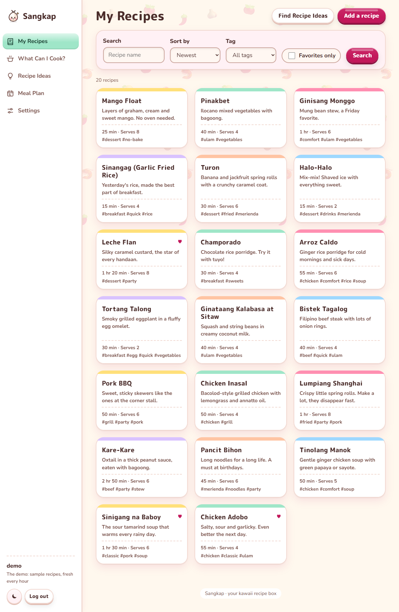 | 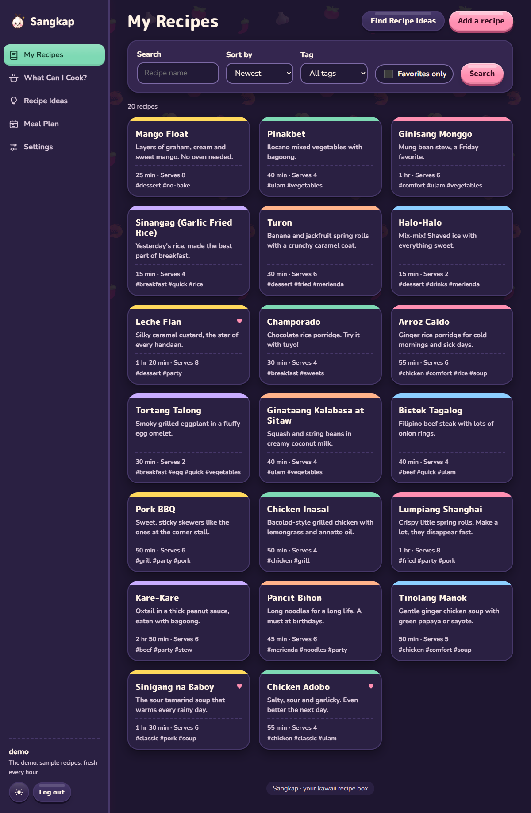 |
| **My Recipes**: every recipe on a card. | The same page in **dark mode**. |
| 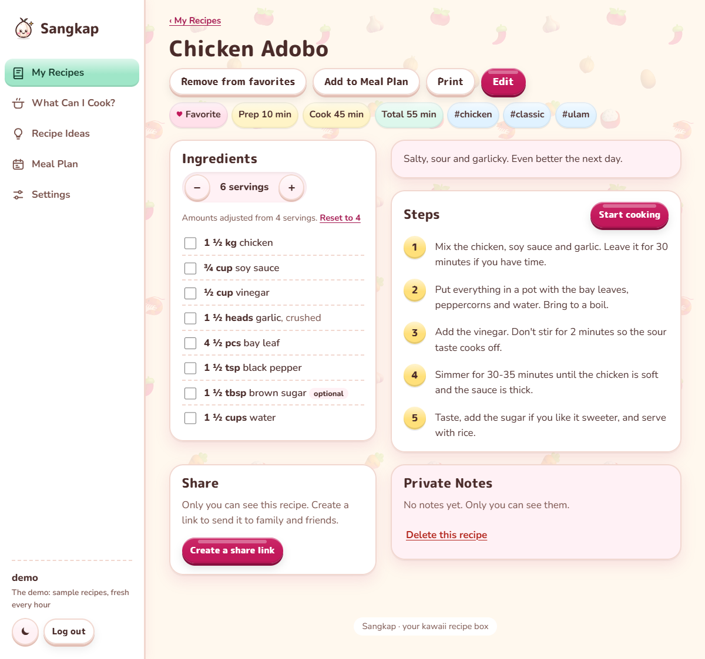 | 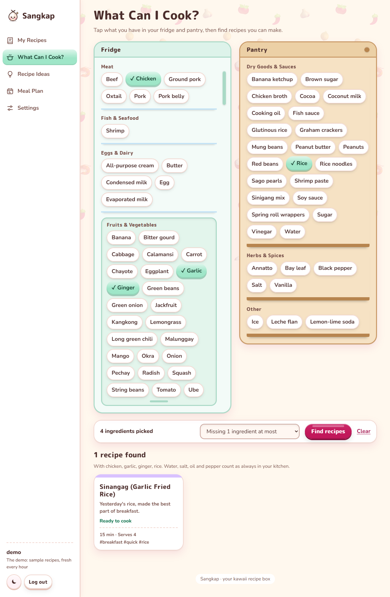 |
| **A recipe** for 6 people: the amounts change. | **What Can I Cook?** Tap what is in your fridge and pantry. |
| 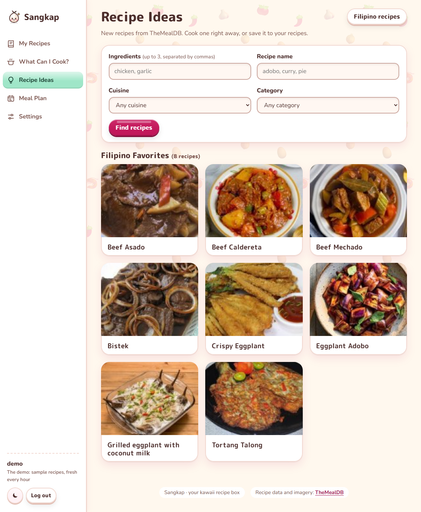 | 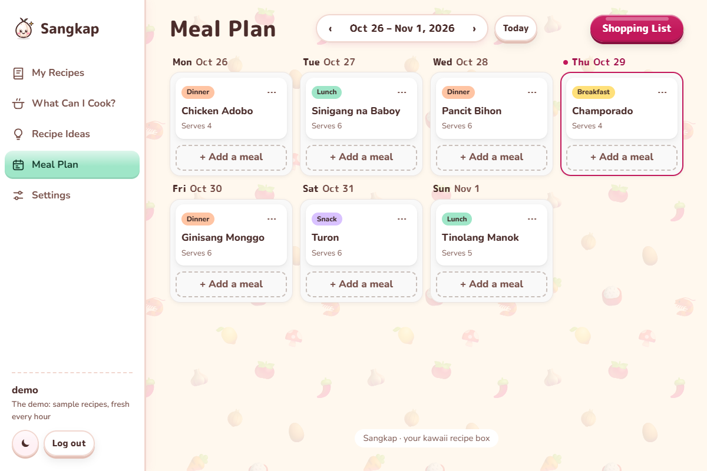 |
| **Recipe Ideas**: new recipes from TheMealDB. | **Meal Plan** for the week. |
| 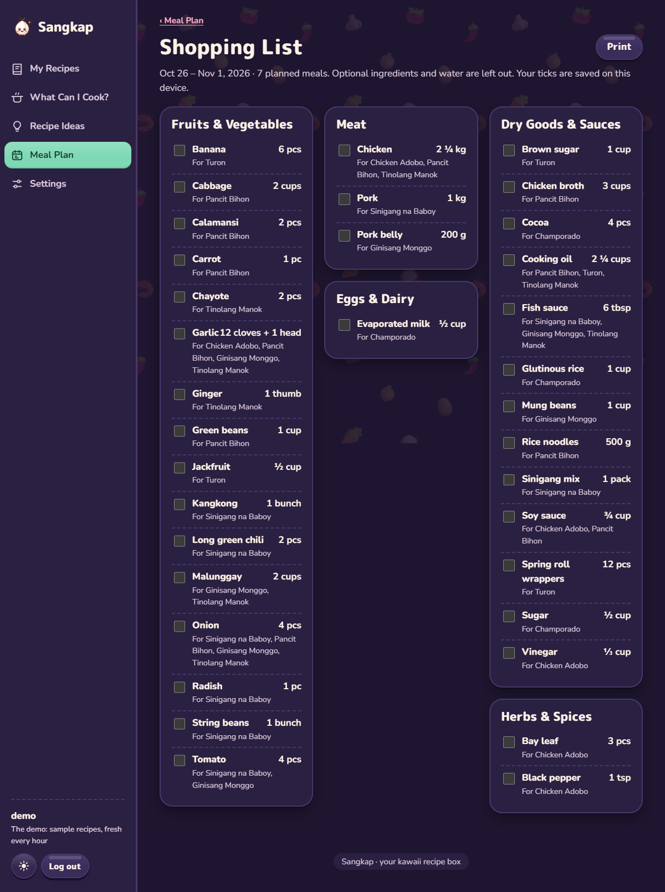 | 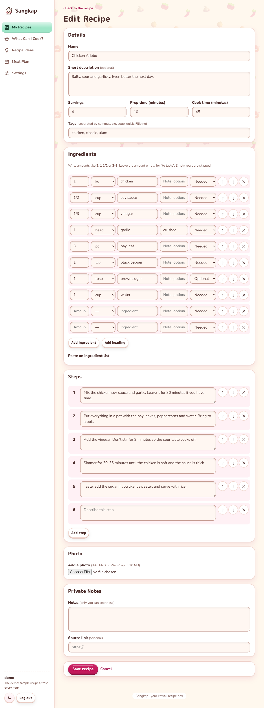 |
| **Shopping List**: amounts are added up. | **Add or edit** a recipe. |
| 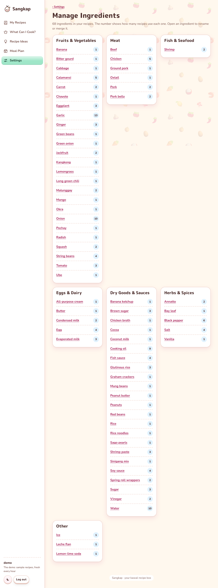 | 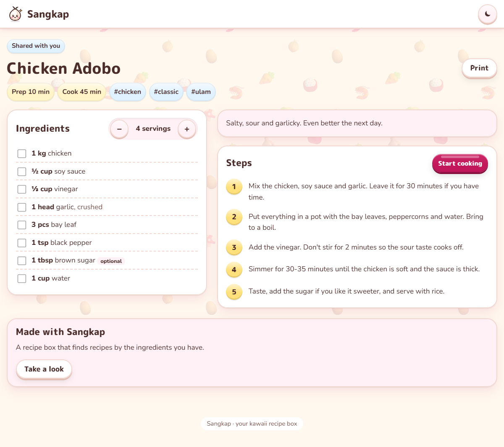 |
| **Manage ingredients**: how many recipes use each one. | **A shared recipe**: anyone with the link can read it. |
| 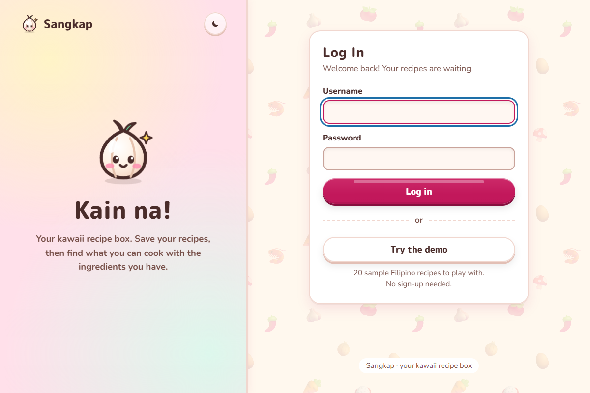 | 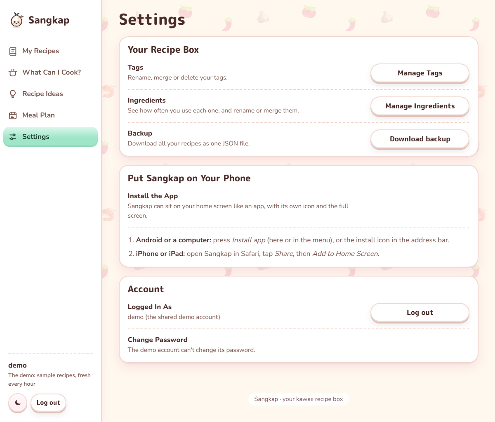 |
| **Log in**, or try the demo. | **Settings**: tags, ingredients, backup and password. |

<p>
  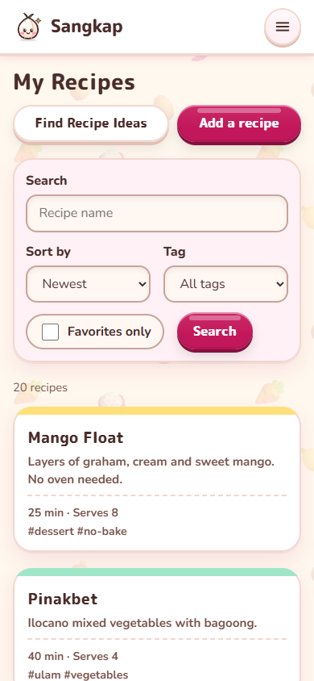
  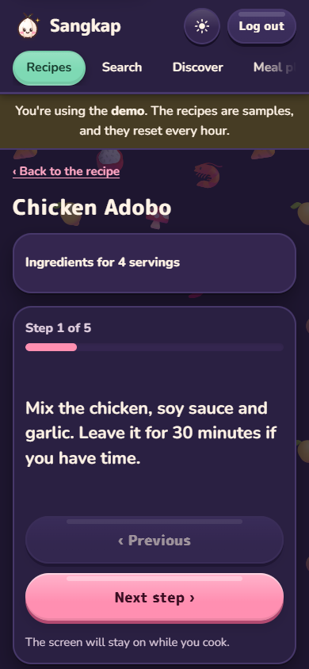
</p>

On a **phone**, and in **cook mode**: big text, one step at a time. The steps slide like pages (you can swipe), and the screen stays on.

## What you can do

| Page | What it does |
|---|---|
| 📖 **My Recipes** | See all your recipes. **Search by name**, sort them, and show one tag or your favorites. |
| ✏️ **Add / edit** | Write the ingredients one per row. Or **paste a whole list** ("2 cups rice", "3 cloves garlic, minced"): Sangkap makes the rows for you. Add steps, tags and a photo. |
| 🍽️ **A recipe** | Press **−** or **+** to cook for more or fewer people. The amounts change (1 ½ cups → 2 ¼ cups). Press **Start cooking** to cook step by step. |
| 🔍 **What Can I Cook?** | Your kitchen as a **fridge** and a **pantry**. **Tap** the ingredients you have, then press **Find recipes**. Choose: ready to cook, missing 1 or 2 things, uses all you picked, or uses any. Water, salt, oil and pepper always count as "in your kitchen". |
| 🌏 **Recipe Ideas** | Find **new** recipes on TheMealDB: by ingredient, by name, or by cuisine (start with **Filipino recipes**). Read one, cook it, or **save it** to your recipes. |
| 📅 **Meal Plan** | Put recipes on the days of the week. Then open the **shopping list**. |
| 🧄 **Manage ingredients** (in Settings) | See how many recipes use each ingredient. Fix a name you wrote two ways ("onions" and "onion"). |
| 💌 **Share** | Make a link for one recipe. Anyone with the link can read it (not your notes). Stop sharing at any time. |
| ⚙️ **Settings** | Manage your tags. Change your password. Download all your recipes (a backup file). |

Filipino and English names both work: **bawang** = garlic, **kamatis** = tomato, **toyo** = soy sauce, **gata** = coconut milk, and many more.

## Try the demo

On the login page, press **Try the demo**.
The demo has 20 Filipino recipes (adobo, sinigang, pancit, leche flan…) and a meal plan.
You can change anything. Every hour, the demo starts fresh again.

## Put it on your phone

Sangkap can sit on your home screen like an app, with its own icon.

- **Android or a computer:** press **Install app** (in the menu, or in Settings), or the install icon in the address bar.
- **iPhone or iPad:** open Sangkap in **Safari**, tap **Share**, then **Add to Home Screen**.

Without internet, the app shows a small "You're offline" page.

## How to run it on your computer

You need **Python 3.13**. In the project folder, type:

```
python -m venv .venv
.venv\Scripts\python -m pip install -r requirements.txt
.venv\Scripts\flask --app sangkap upgrade-db
.venv\Scripts\flask --app sangkap create-user yourname
.venv\Scripts\flask --app sangkap run --debug --port 5003
```

Then open **http://127.0.0.1:5003** in your browser.

To run the tests:

```
.venv\Scripts\python -m pytest
```

The tests do not use the internet.

## The kawaii background picture

The background shows small food pictures.
Now it uses food emoji. You can make a **cute 3D picture** with a free AI tool and use it instead.
The steps are in [docs/ART_PROMPTS.md](docs/ART_PROMPTS.md).

## How the data is saved

This project is for practising **data modeling**, **search** and **many-to-many** links.

```
users ─┬─< recipes ─┬─< recipe_ingredients >── ingredients ─< ingredient_aliases
       │            ├─< steps
       │            ├── photos
       │            └─< recipe_tags >── tags
       ├─< tags
       └─< plan_entries >── recipes
```

- One recipe has many ingredients, and one ingredient is in many recipes. That is **many-to-many**.
  The link (`recipe_ingredients`) also keeps the amount, the unit and a note: "1 ½ cups coconut milk (gata)".
- One recipe has many tags, and one tag is on many recipes. That link (`recipe_tags`) keeps only the two ids.
- "Garlic" is saved **one time**. Every recipe points to it. So "find recipes with garlic" is fast and exact.

## Tools, languages and platforms

| Name | What it is | What we use it for |
|---|---|---|
| **Python** | A programming language | All the code on the server |
| **Flask** | A small web framework for Python | The pages and the login |
| **SQLAlchemy** | An ORM: Python classes for database tables | The data model (`models.py`) and the search |
| **Alembic** | A migration tool | Making and changing the database tables |
| **SQLite** | A small database in one file | The database on your computer and in tests |
| **PostgreSQL (Neon)** | A big database in the cloud (free plan) | The database of the live website |
| **Pillow** | A Python library for pictures | Making photos small, and the background picture |
| **TheMealDB** | A free recipe website with an API | The Recipe Ideas page |
| **HTML, CSS, JavaScript** | The languages of web pages | The kawaii look, dark mode, cook mode |
| **pytest** | A testing tool | About 200 tests |
| **Render** | A website host (free plan) | Running the live website |
| **GitHub** | A home for code | Keeping the code and the pull requests |

Recipe data and imagery on Recipe Ideas: [TheMealDB](https://www.themealdb.com/).

## Put it on the internet (Render + Neon)

Render's free plan forgets files when it restarts.
So the recipes and photos are saved in **Neon**, a free PostgreSQL database.

1. **Neon:** go to [neon.tech](https://neon.tech), make a project called `sangkap`, and choose the **Singapore** region.
   Copy the **connection string** (it starts with `postgresql://`).
2. **Render:** go to [render.com](https://render.com), choose **New → Blueprint**, and pick this repository.
   Render reads `render.yaml`. When it asks for `DATABASE_URL`, paste the Neon connection string.
3. Wait for the first deploy. Render makes the tables by itself (`upgrade-db`).
4. Make your login from your own computer, with the Neon connection string (PowerShell):
   ```
   $env:DATABASE_URL = "postgresql://...your Neon string..."
   .venv\Scripts\flask --app sangkap create-user yourname
   Remove-Item Env:DATABASE_URL
   ```
5. Open your website and log in. 🎉
